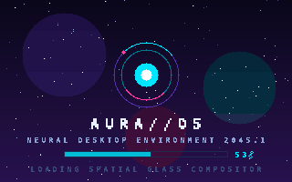
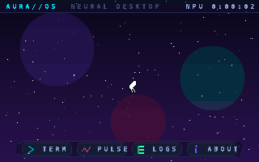
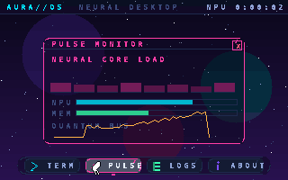
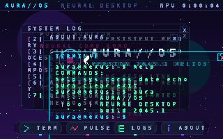

# AURA//OS — Neural Desktop Environment 2045.1 "HELIOS"

A from-scratch, **bootable 32-bit x86 operating system** with a custom
bootloader, a capability-style kernel and a neon glassmorphism desktop —
no GRUB, no NASM, no libc, no external dependencies at runtime.

```
            .--.
           |o_o |   AURA//OS 2045.1
            '--'    ADAPTIVE UNIFIED RUNTIME ARCHITECTURE
```

## What is inside

- **Two-stage bootloader written in GNU as** (`boot/boot.s`): BIOS disk
  reads (CHS, retries), VGA mode 13h (320×200×256), BIOS font capture,
  A20 gate, GDT, protected-mode jump into the kernel at `0x10000`.
- **Freestanding C kernel** (`kernel/`): IDT + remapped 8259 PIC, PIT
  scheduler tick, PS/2 keyboard (Set-1 scancodes, Shift) and PS/2 mouse
  with IRQ12 packet parsing, software double buffer, 256-color custom
  DAC palette with precomputed glass blending, integer math (no FPU).
- **Window manager + desktop** (`kernel/ui/`): z-order, focus, draggable
  glass windows, animated starfield/nebula wallpaper, dock, top bar,
  custom cursor, cinematic boot sequence, four apps:
  - **Terminal** — working shell: `help sys cores date echo aura clear exit`
  - **Pulse Monitor** — live core-load bars, NPU/MEM gauges, bus sparkline
  - **System Log** — ring buffer of boot/runtime events, word wrapping
  - **About Aura** — animated orbital system badge
- **Host simulator** (`host/`): the *exact same kernel C* compiles on Linux
  and renders PPM/PNG screenshots with scripted input — so the UI can be
  developed and tested without QEMU or real hardware.

## Screenshots

Boot sequence, desktop, pulse monitor and a multi-window workspace:






## Quickstart

### 1. Run the host simulator (no hardware, no QEMU)

```sh
make sim            # build user-space simulator
./build/sim         # runs a scripted 5-second session, writes PPM frames
python3 host/shot.py
```

or simply:

```sh
make shots
```

### 2. Build the bootable floppy image

Requires a 32-bit freestanding compiler (`gcc-multilib` on Debian/Ubuntu):

```sh
make all            # -> aura.img (1.44 MiB raw floppy image)
```

### 3. Boot it

```sh
make run            # qemu-system-i386 -fda aura.img -serial stdio -m 32
# or:
./scripts/run-qemu.sh
```

Mouse: QEMU captures the PS/2 mouse (Ctrl+Alt+G releases it). Keyboard
input goes to the Terminal while it is focused.

### 4. Debug with GDB

```sh
make debug          # QEMU frozen, GDB stub waiting on tcp::1234
gdb build/kernel.bin -ex 'target remote :1234' -ex 'break kernel_main'
```

### Real hardware

`aura.img` is a raw 1.44 MB floppy image. Write it to a USB stick and boot
with the BIOS in USB-FDD emulation mode:

```sh
sudo dd if=aura.img of=/dev/sdX bs=512 status=progress
```

It also attaches directly as a floppy in VirtualBox / VMware.

## Repository layout

| Path              | Purpose                                            |
|-------------------|----------------------------------------------------|
| `boot/`           | stage 1 MBR + stage 2 protected-mode boot chain   |
| `kernel/`         | freestanding C kernel, drivers, graphics, UI      |
| `kernel/ui/`      | window manager, desktop shell, bundled applications|
| `host/`           | user-space simulator shims + PPM→PNG converter    |
| `tools/`          | disk image builder and bitmap-font generator       |
| `scripts/`        | QEMU convenience wrapper                           |
| `screenshots/`    | rendered reference frames from the simulator       |

See [`docs/ARCHITECTURE.md`](docs/ARCHITECTURE.md) for the full memory map,
disk layout and boot sequence.

## Design language

Deep-space indigo base, cyan/magenta/mint/violet neon accents, glass panels
via a precomputed 256×256 alpha-blend table, 32-step perceptual color ramps,
parallax starfield and orbital motion driven by an integer sine LUT —
a vision of a 2045 spatial desktop constrained to a 1987 VGA mode.
